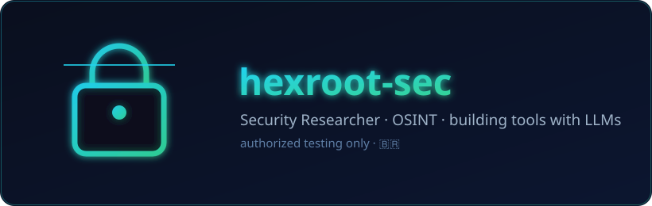

<h1 align="center">hexroot-sec</h1>

  

  <b>Security Researcher · OSINT Specialist · Content Creator · building tools with LLMs</b>

🇧🇷 Brasil · learning &amp; building in public

  
  

---

### 🔭 About

Offensive-security researcher focused on **OSINT** and **recon automation**, with ~4 years on
**HackerOne** and **Bugcrowd** (authorized bug bounty only). I build tooling — increasingly
**with LLMs** — and share what I learn on my YouTube channel
[**Estudando Bug Bounty**](https://www.youtube.com/@HexRo0t).

### 🎓 Certifications &amp; Training (Solyd)

- ✅ **Pentest do Zero ao Profissional** — SYCP **v2023**
- ✅ **Pentest do Zero ao Profissional** — SYCP **v2022**
- ✅ **Workshop Android Pentester**
- ✅ **Introdução ao Hacking e Pentest 2.0**

### 📌 Projects

| Repo | What it is |
|---|---|
| [**hexrootadm-bugbounty-toolkit**](https://github.com/hexroot-sec/hexrootadm-bugbounty-toolkit) | Containerized recon pipeline for **authorized** bug bounty (subfinder → httpx → naabu → gau → nuclei) with a mandatory scope gate |
| [**Payloads-simples-xss**](https://github.com/hexroot-sec/Payloads-simples-xss) | XSS payloads for study (authorized use) |
| [**ache_RAT**](https://github.com/hexroot-sec/ache_RAT) | Webcam computer-vision demos (hand/face tracking, MediaPipe) |
| [**lotofacil_analise**](https://github.com/hexroot-sec/lotofacil_analise) | Honest statistical analysis: blind tests, sealed holdout, pre-registration |

### 🧰 Stack

   

### ⚖️ Ethics

All offensive-security material here is for **educational and research purposes**, to be used
**only** against systems you own or are **explicitly authorized in writing** to test.
Each repo ships its own `AVISO.md`.

### 📊 Stats

  
  

